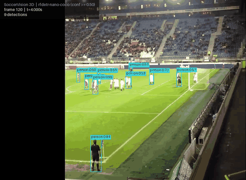
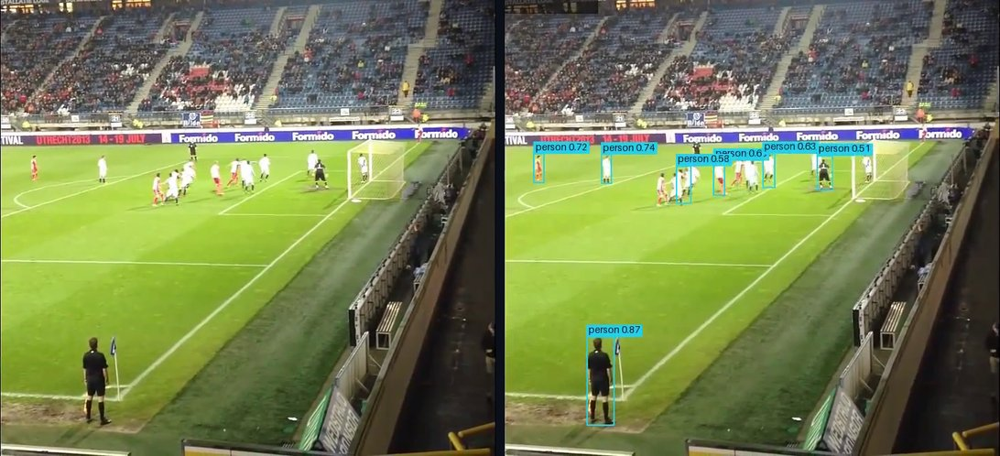
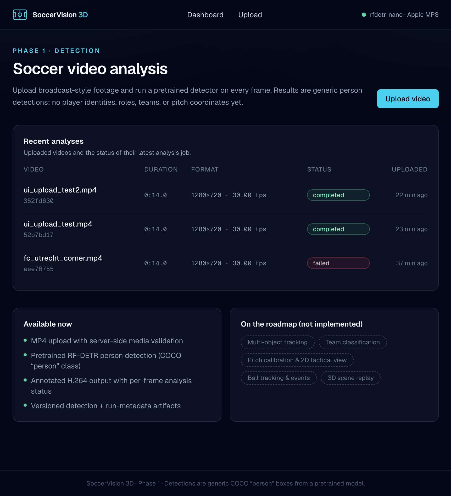
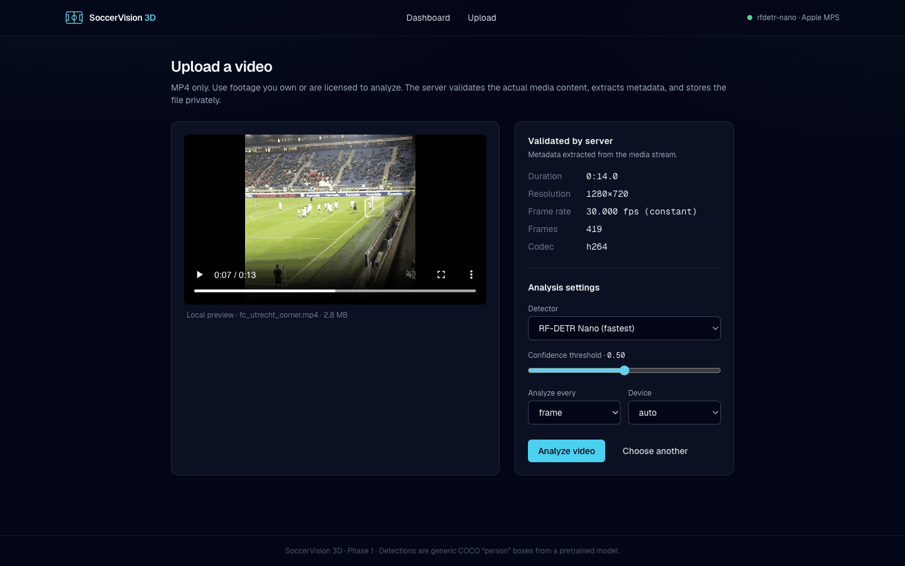
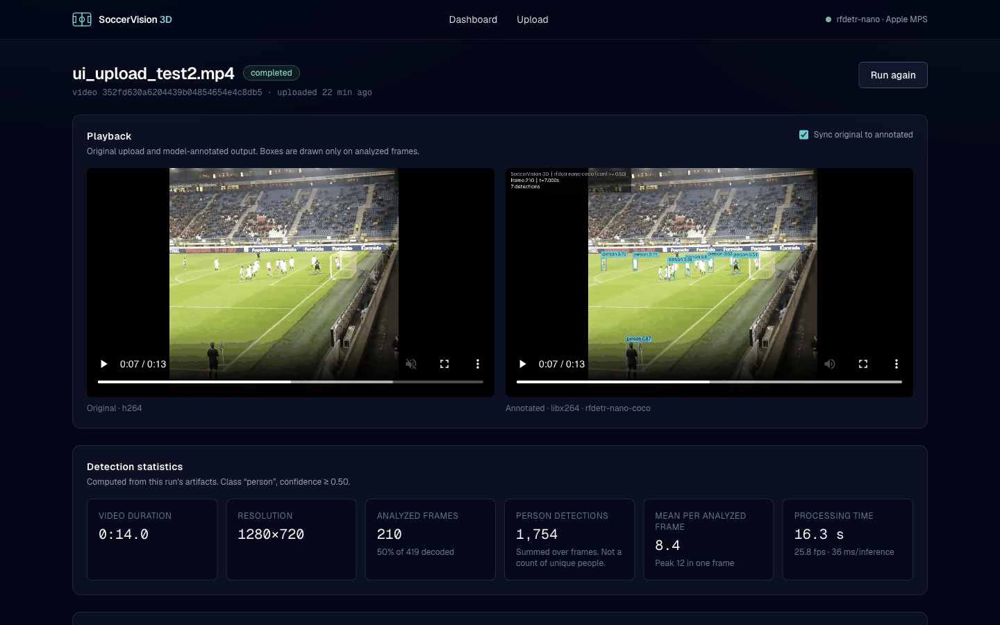
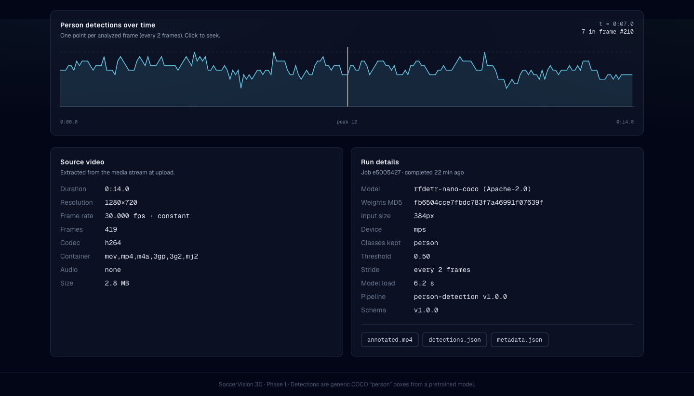

# SoccerVision 3D

This is an open-source computer-vision pipeline for soccer videos. It is being built in small, tested milestones toward multi-object tracking, team classification, pitch calibration, ball tracking, event recognition, and an interactive 3D replay.

**Current status:**

- **Phase 1 (detection platform): complete.** You upload an MP4. A pretrained [RF-DETR](https://github.com/roboflow/rf-detr) model detects the COCO `person` class on every analyzed frame, and you get an annotated, browser-playable video plus versioned JSON artifacts.
- **Phase 2A (detection evaluation): in progress.** Milestones 2A.1 and 2A.2 are complete: an offline COCO evaluation module with dataset validation, detection metrics, and export of RF-DETR predictions over a dataset's images. The next milestone, **2A.3**, adds an evaluation CLI.

> Phase 1 detects *generic people*. It does not identify players, tell players from referees or spectators, assign teams, track identities across frames, or estimate pitch positions. Those are [roadmap](docs/ROADMAP.md) items and are **not implemented**. No detection accuracy has been measured on real soccer footage yet.

<p align="center">
  
  <br>
  <sub>Real output of RF-DETR Nano (MPS, 384 px input, confidence ≥ 0.50), frames 120–270 of the annotated video, downscaled to a GIF. The overlay shows the model, frame, timestamp and detection count.</sub>
</p>

## Results

These are real runs on a 14-second, 1280×720, 30 fps corner-kick clip ([source and license](#sample-clip)), using the default model, RF-DETR Nano at its native 384 px input with confidence 0.5, on an Apple Silicon Mac:

| Device | Analyze every | Frames analyzed | Detections (summed over frames) | Mean per analyzed frame | Peak in one frame | Inference time | End-to-end |
| --- | --- | --- | --- | --- | --- | --- | --- |
| Apple MPS | frame | 419 / 419 | 3,502 | 8.4 | 12 | 38.6 ms/frame | 25.7 s (16.3 fps) |
| CPU | frame | 419 / 419 | 3,502 | 8.4 | 12 | 58 ms/frame | 32.3 s (13.0 fps) |
| Apple MPS | 2 frames | 210 / 419 | 1,754 | 8.4 | 12 | 35.6 ms/frame | 16.3 s (25.8 fps) |

End-to-end time includes about 6 s of model loading per job. These are throughput and behaviour measurements, **not accuracy metrics**. No precision, recall or mAP has been measured yet (see [docs/MODEL_EVALUATION.md](docs/MODEL_EVALUATION.md)).

**Original and annotated output, frame 210.** Players in and around the box are detected, mostly at 0.5–0.9 confidence, and so is the official standing by the corner flag in the foreground, because the model only knows "person". Several small, distant players near the far post are missed. That is the main weakness of Nano at 384 px.



### Web app

| Dashboard | Upload and server-side validation |
| --- | --- |
|  |  |

**Analysis page.** The original and annotated players stay in sync. Statistics are computed from the run's artifacts. With "analyze every 2 frames", the page reports that 50% of frames were analyzed, and the skipped frames are excluded from the averages rather than counted as zero.



**Detection timeline and run provenance.** The timeline has one point per analyzed frame and you can click it to seek. Run details record the model, weights MD5, input size, device, threshold, stride, pipeline and schema version, with links to the raw artifacts.



The dashboard lists one `failed` video on purpose. That job was interrupted by a deliberate server kill-and-restart test, and the app reports it as `interrupted` while still showing the earlier completed run for that video.

## What works today

| Area | Implemented |
| --- | --- |
| Upload | `POST /api/v1/videos`: MP4 only, validated by demuxing and decoding the real media; size and duration limits; metadata extracted with FFmpeg (via PyAV) |
| Detection | RF-DETR Nano / Small / Medium (COCO-pretrained, Apache-2.0); configurable confidence, frame stride, input resolution, and device (CPU / Apple MPS / CUDA) |
| Jobs | Persistent SQLite job queue; bounded pool of worker **subprocesses**; real frame-based progress; restart reconciliation; `PENDING → PROCESSING → COMPLETED / FAILED` |
| Artifacts | `annotated.mp4` (H.264, `yuv420p`, faststart), `detections.json`, and `metadata.json` with a versioned schema ([data contracts](docs/DATA_CONTRACTS.md)) |
| Frontend | Next.js dashboard, drag-and-drop upload, and an analysis page with synced original and annotated players, a per-frame detection timeline, run metadata, and job status |
| CLI | `python -m soccervision.cli analyze`, using the same pipeline as the API |
| Evaluation (offline library) | `soccervision.evaluation`: COCO ground-truth loading and validation, category mapping, dataset provenance and SHA-256, COCO prediction loading, RF-DETR prediction export (COCO results plus reproducibility metadata), and `person` detection metrics (mAP@0.50, mAP@0.50:0.95, precision, recall, recall by object size) via `pycocotools`. Python API only, with no CLI yet. Metrics have so far been computed only on synthetic test fixtures ([details](docs/MODEL_EVALUATION.md)). |

Frames that are skipped by `inference_stride` are recorded as `"inference_status": "skipped"` with `detections: null` and are labelled **NOT ANALYZED** in the output video. They are never reported as zero detections.

## Architecture

```text
apps/web (Next.js) ──HTTP──▶ apps/api (FastAPI) ──SQLite job row──▶ worker subprocess
                                   │                                     │
                                   │                       packages/soccervision pipeline
                                   │                      decode ▶ detect ▶ annotate ▶ export
                                   ▼                                     ▼
                           data/uploads/{video_id}/         data/artifacts/{video_id}/{run_id}/
```

See [docs/ARCHITECTURE.md](docs/ARCHITECTURE.md) for the design and its trade-offs.

```text
apps/api/soccervision_api/    FastAPI app, job runner, worker entrypoint, SQLite persistence
apps/web/                     Next.js 16 frontend (TypeScript, Tailwind CSS 4)
packages/soccervision/        Core library: schemas, video I/O, detectors, annotation, pipeline, evaluation, CLI
scripts/                      Weight download and MP4 conversion helpers
tests/                        Unit, API, and opt-in integration tests
docs/                         Architecture, roadmap, development, data contracts, model evaluation
data/  models/                Local runtime data and weights (git-ignored)
```

## Documentation

| Document | Contents |
| --- | --- |
| [ARCHITECTURE.md](docs/ARCHITECTURE.md) | Components, key design decisions and trade-offs, data flow |
| [ROADMAP.md](docs/ROADMAP.md) | The 11-phase plan, broken into small milestones with dependencies and metrics |
| [DEVELOPMENT.md](docs/DEVELOPMENT.md) | Environment setup, checks, test layout, conventions, troubleshooting |
| [DATA_CONTRACTS.md](docs/DATA_CONTRACTS.md) | Artifact and API schemas, plus planned schemas |
| [MODEL_EVALUATION.md](docs/MODEL_EVALUATION.md) | The evaluation module, metric definitions, and what has and hasn't been measured |
| [PHASE1_HANDOFF.md](docs/PHASE1_HANDOFF.md) | Historical snapshot of the Phase 1 implementation report |

## Requirements

- Python **3.12 or 3.13**. The test suite has been run locally on 3.13.12 and 3.12, and CI is configured for both.
- Node.js **≥ 22.12** (developed on Node 24) and npm.
- **FFmpeg is not required separately.** PyAV wheels bundle FFmpeg, including the libx264 H.264 encoder.
- Optional: an NVIDIA GPU with CUDA, or Apple Silicon (MPS). CPU works everywhere, just more slowly.
- About 400 MB of disk for RF-DETR Nano weights (larger variants need more).

## Quick start

```bash
# 1. Backend
python3.13 -m venv .venv
source .venv/bin/activate
pip install -e ".[ml,api,eval,dev]"
cp .env.example .env                 # optional; defaults work as-is

# Optional: fetch weights ahead of time (otherwise downloaded on first analysis; MD5-verified, and a corrupt file is rejected when downloads are disabled)
python scripts/download_weights.py --model rfdetr-nano

uvicorn soccervision_api.main:app --port 8000
```

```bash
# 2. Frontend (second terminal)
cd apps/web
npm ci
cp .env.example .env.local           # NEXT_PUBLIC_API_BASE_URL=http://localhost:8000
npm run dev                          # http://localhost:3000
```

Open <http://localhost:3000>, upload an MP4, and click **Analyze video**. Run the API from the repository root so that the relative `data/` and `models/` paths resolve.

On Linux without a GPU, install CPU-only PyTorch first to avoid multi-GB CUDA wheels:
`pip install torch torchvision --index-url https://download.pytorch.org/whl/cpu`.

### Sample clip

No source footage is committed; only the small demo images and GIF in `docs/media/` are. For a quick test with a freely licensed clip, see [data/samples/README.md](data/samples/README.md). It uses ["FC Utrecht takes a Corner"](https://commons.wikimedia.org/wiki/File:FC_Utrecht_takes_a_Corner.ogv) by Pel Laurens, [CC BY 3.0](https://creativecommons.org/licenses/by/3.0/), via Wikimedia Commons. Only analyze footage you have the right to use.

The images and GIF in `docs/media/` are derived from that clip. They were re-encoded, annotated with model detections, cropped and downscaled, and are shared under the same CC BY 3.0 terms.

## CLI

```bash
python -m soccervision.cli analyze \
  --input data/samples/fc_utrecht_corner.mp4 \
  --output data/artifacts/cli-run \
  --model rfdetr-nano --confidence 0.5 --stride 1 --device auto

python -m soccervision.cli devices      # show which compute devices PyTorch can use
```

The CLI writes the same three artifacts as the API and prints a JSON summary. Exit codes are `0` (completed), `1` (failed, with `metadata.json` describing the error), and `2` (usage error).

## API

| Method | Path | Purpose |
| --- | --- | --- |
| `GET` | `/api/v1/health` | Versions, available devices, model and weight status, limits, defaults |
| `POST` | `/api/v1/videos` | Upload an MP4 (`multipart/form-data`, field `file`) |
| `GET` | `/api/v1/videos` · `/api/v1/videos/{id}` | List videos and get one video's metadata and latest job |
| `DELETE` | `/api/v1/videos/{id}` | Delete a video, its jobs and all artifacts (`204`; `409` while a job is active) |
| `GET` | `/api/v1/videos/{id}/source` | Original upload (supports HTTP Range) |
| `POST` | `/api/v1/videos/{id}/analyze` | Queue an analysis job (`202`; `409` if one is already active) |
| `GET` | `/api/v1/jobs/{job_id}` | Job status, progress, error, artifact URLs |
| `GET` | `/api/v1/videos/{id}/results` | Latest completed run: metadata plus per-frame detection counts |
| `GET` | `/api/v1/jobs/{job_id}/artifacts/{name}` | `annotated.mp4`, `detections.json`, or `metadata.json` |

Errors use the shape `{"error": {"code": "...", "message": "...", "details": {...}}}`. Interactive docs are at <http://localhost:8000/docs>.

## Configuration

All backend settings are `SOCCERVISION_*` environment variables, and `.env` is also read. See [.env.example](.env.example) for the full list. The main ones are data and weights directories, upload size and duration limits, `MAX_CONCURRENT_JOBS`, default detector, device, confidence, and stride, and CORS origins.

## Tests and checks

```bash
pytest                                   # unit, API and evaluation tests (fake detectors; no GPU, no downloads)
ruff check . && ruff format --check .
mypy                                     # strict

# Opt-in real inference (uses or downloads real RF-DETR weights):
SOCCERVISION_RUN_INTEGRATION=1 \
SOCCERVISION_INTEGRATION_VIDEO=data/samples/fc_utrecht_corner.mp4 \
SOCCERVISION_WEIGHTS_DIR=models pytest tests/integration

cd apps/web && npm run lint && npm run typecheck && npm test && npm run build
```

The fake detectors used in tests are marked `is_synthetic: true` in every artifact they produce, and the pipeline adds a warning. They are never used by the API or CLI. See [docs/DEVELOPMENT.md](docs/DEVELOPMENT.md) for the test layout, CI and troubleshooting.

## Docker (API, CPU)

```bash
docker build -t soccervision-api .
docker run --rm -p 8000:8000 -v "$PWD/data:/app/data" -v "$PWD/models:/app/models" soccervision-api
```

The Dockerfile has not been built in the development environment (Docker was not installed there). Treat it as untested.

## Known limitations

- **COCO `person` is not "player".** Referees, coaches, ball kids, and visible spectators are all detected. There is no tracking, so each frame's boxes are independent and `total_detections` counts boxes summed over frames, not unique people.
- **Small, distant players are missed.** This is most noticeable with Nano at its native 384 px input, for example players near the far goal in wide shots. Small or Medium, or a larger `inference_resolution` (a multiple of 32), helps at a speed cost.
- Accuracy has not been measured on a labelled soccer dataset. The evaluation module and prediction exporter exist, but there is no evaluation CLI or real soccer evaluation set yet, and only the `person` class is evaluated. See [docs/MODEL_EVALUATION.md](docs/MODEL_EVALUATION.md).
- Uploads must be MP4. The CLI accepts any container FFmpeg can read. Audio is not carried into the annotated video.
- Single host only. SQLite and local disk, no authentication, and not designed for public internet exposure.
- There is no retention policy. Uploads and artifacts stay until you delete the video (the **Delete** button on the analysis page, or `DELETE /api/v1/videos/{id}`).
- Each job loads the model in a fresh worker subprocess, which adds about 6 s per job.

## Roadmap

The full plan is in [docs/ROADMAP.md](docs/ROADMAP.md). In short, everything after milestone 2A.2 is **planned, not implemented**:

| Phase | Goal |
| --- | --- |
| 2A | Detection evaluation: evaluation CLI (**2A.3, next**), a real soccer evaluation set, model comparison |
| 2B | Multi-object tracking (Kalman filtering, ByteTrack), with camera-motion compensation |
| 3 | Team classification, pitch calibration (RANSAC homography), 2D tactical replay |
| 4 | Soccer-specific detection: fine-tuning and teacher-student distillation |
| 5 | Ball tracking: trajectory linking and physics-aware motion estimation |
| 6 | Events: possession state machine, Viterbi decoding, pass and shot recognition |
| 7 | Interactive 3D replay (Three.js), heatmaps, passing networks |
| 8 | Synthetic soccer simulator with ground-truth trajectories and events |
| 9 | Benchmarking, ablation studies and inference optimization |
| 10 | Production infrastructure (queues, PostgreSQL, object storage, GPU workers, observability) |
| 11 | Optional: grounded natural-language queries, real-time processing, advanced 3D pose |

## Licensing

SoccerVision 3D is licensed under the [Apache License 2.0](LICENSE). Notable dependencies:

| Component | License | Notes |
| --- | --- | --- |
| [RF-DETR](https://github.com/roboflow/rf-detr) code and N/S/M COCO weights | Apache-2.0 | Weights are downloaded at runtime and never committed. Trained on COCO. |
| [supervision](https://github.com/roboflow/supervision) | MIT | Pulled in by RF-DETR |
| [pycocotools](https://github.com/ppwwyyxx/cocoapi) | BSD-2-Clause | Optional `eval` extra; reference COCO detection metrics |
| [PyAV](https://github.com/PyAV-Org/PyAV) | BSD-3-Clause | Wheels bundle FFmpeg (reports LGPL-3.0+) linked with **libx264 and libx265 (GPL-2.0+)**. Redistributing binaries or images that contain them carries GPL obligations. |
| PyTorch / torchvision | BSD-3-Clause | |
| FastAPI, Pydantic, Next.js, React | MIT | |

**Ultralytics (YOLO) is deliberately not a dependency.** It is AGPL-3.0, or requires a commercial license, which would impose network-copyleft obligations on anyone deploying this service. Any future use must be documented and opt-in.
