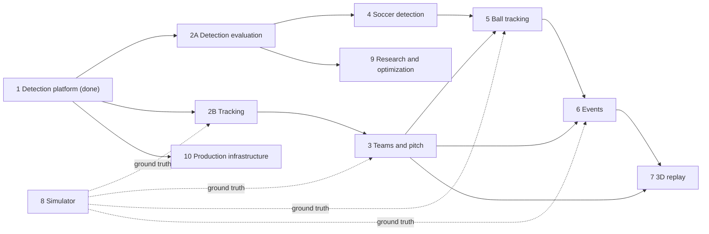

# Roadmap

SoccerVision 3D is built in small, independently testable milestones. **Implemented today:** Phase 1 (the detection platform) and milestone 2A.1 (COCO dataset loading and detection metrics). Everything else on this page is planned work that does not exist in the code. Scope and order will change as evaluation results come in.

## How to read this roadmap

- **Milestone size.** Each milestone (for example `2A.2`) is meant to be one focused change with its own tests, reviewable as one commit. If a milestone turns out larger, the smallest coherent subset ships first and the rest is split off.
- **Status values.** `Done` means the code exists in the repository and is tested. `Next` is the milestone currently being worked on. `Planned` means not started. Nothing is marked `Done` on the strength of a plan or a design.
- **Kind.** Every milestone is one of:
  - `product`: functionality used by the API, CLI or web app.
  - `eval`: measurement tooling and benchmarks. It never changes what the product outputs.
  - `research`: an experiment whose result decides whether something becomes `product`. A research milestone can end with a negative result, and that result is documented rather than hidden.
- **Dependencies** list the milestones that must be `Done` first. Most phases are not strictly sequential; see [Dependencies between phases](#dependencies-between-phases).
- **Honesty rules** carry over from Phase 1 into every phase:
  - Skipped frames are never treated as empty frames.
  - Derived values (predictions, interpolations, projections) carry a source that distinguishes them from model observations.
  - No metric is reported without the dataset, split, model version and configuration that produced it.
  - Synthetic benchmark scores are never presented as real-footage performance.

## Status overview

| Phase | Goal | Status |
| --- | --- | --- |
| 1 | Video → decode → person detection → annotated video and JSON artifacts; API, background jobs, web UI, CLI, tests and CI | **Done** |
| 2A | Detection evaluation, prediction export, benchmarking and detection optimization | **In progress** (2A.1 done, 2A.2 next) |
| 2B | Multi-object tracking: Kalman filtering, ByteTrack, ReID, local identities and trajectories | Planned |
| 3 | Team classification, pitch calibration (RANSAC homography) and 2D tactical replay | Planned |
| 4 | Soccer-specific detection: fine-tuning and knowledge distillation | Planned |
| 5 | Ball tracking: temporal trajectory association and physics-aware motion estimation | Planned |
| 6 | Event inference: possession state machine, Viterbi decoding, passes and shots | Planned |
| 7 | Interactive 3D replay: Three.js scene, heatmaps and passing networks | Planned |
| 8 | Synthetic soccer simulator with ground-truth trajectories and events | Planned |
| 9 | ML benchmarking, ablation studies, model optimization and research write-up | Planned |
| 10 | Production infrastructure: Redis, PostgreSQL, S3, GPU workers, caching, observability | Planned |
| 11 | Optional: natural-language match analysis, real-time processing, advanced 3D pose | Optional |

### Phase numbering change

The historical [PHASE1_HANDOFF.md](PHASE1_HANDOFF.md) uses the original seven-phase numbering. It maps onto the current phases as follows:

| Original phase | Current phase |
| --- | --- |
| 2: multi-object tracking | 2B |
| 3: team classification and 2D pitch mapping | 3 |
| 4: ball intelligence and events | 5 (ball) and 6 (events) |
| 5: interactive 3D reconstruction | 7 |
| 6: research and evaluation | 2A (detection evaluation) and 9 (research) |
| 7: production architecture | 10 |

Phases 4 (soccer-specific detection), 8 (simulator) and 11 (optional features) are new.

## Ideas adapted from CourtVision

[CourtVision](https://github.com/aiden-guan/courtvision) (MIT) applies computer vision and temporal reasoning to single-camera basketball video. Several of its engineering ideas transfer to soccer. They are reimplemented here for soccer's rules and geometry, not copied:

| CourtVision idea | Soccer adaptation | Phase |
| --- | --- | --- |
| Measure everything from the video and use external data only as ground truth for scoring | Report only what the pipeline observed or inferred. Any labelled or official data is used for evaluation, never as an input that hides weak vision. | All |
| A small, fast student detector distilled from an RF-DETR teacher, with a few frames of temporal context so a motion-blurred ball stands out | Distil RF-DETR into a smaller soccer detector, and test whether a short frame stack improves small-ball recall | 4 |
| Per-frame camera registration: solve the fixed camera position once, then fit only pan, tilt, roll and zoom per frame, and reject physically impossible cameras | Main-camera calibration from pitch lines with a physical plausibility gate. The same gate flags close-ups and replays as "not live play". | 3 |
| One ball path linked through per-frame candidates by dynamic programming, with the camera's own motion subtracted from the motion cost | Ball candidate linking with camera-motion compensation. Soccer adds long ground passes, long invisible stretches and many ball-like distractors. | 5 |
| 3D ballistic fitting of airborne stretches, where gravity supplies the depth a single camera cannot see | Ballistic fits only for lofted passes, crosses and shots, with explicit uncertainty. Ground passes are modelled as rolling with friction, on the pitch plane. | 5 |
| Possession decided over the whole sequence with Viterbi instead of greedy per-frame votes, using camera aim as evidence | An HMM over possession states (team A, team B, contested, out of play) decoded with Viterbi. A soccer broadcast camera also follows the ball, so its aim is evidence of where play is. | 6 |
| Uncertain events say why, and a human can confirm them | Event confidence plus a "check this" correction flow; confirmed and inferred events are stored separately | 6 |
| A seeded simulator with exact positions, ball flight and events, scored on held-out seeds at several perception levels (perfect 3D, noisy monocular, rendered video) | A soccer simulator scored at the same three levels, so tracking, calibration and event logic can each be isolated | 8 |
| Held-out evaluation: fit on one half or game, score on another; report the shortfalls | Splits by match, never by frame. Results tables state what was held out and how. | 2A, 9 |
| Optional language features grounded in the event log, with a validator and deterministic fallbacks | Natural-language queries answered only from structured, evidence-backed match data | 11 |

Soccer-specific challenges that basketball does not have: a much larger field with many small, distant players; frequent pans, zooms, cuts and replays; long periods where the ball is not visible; players off-screen for long stretches; offside-driven tactical shape; and different possession and restart rules.

## Dependencies between phases

- **Phase 8 can start early.** Its first milestones only need the pitch coordinate model, and its ground truth makes Phases 2B, 3, 5 and 6 measurable before real annotated data exists.
- **Phase 10 is independent.** Each infrastructure milestone is taken on only when a real limitation needs it (for example, the roughly 6 s model load per job motivates 10.1).
- **Phase 9 grows alongside the others.** It collects the evaluation tooling each phase adds into reproducible experiments.

### Suggested near-term order

1. 2A.2 → 2A.3: prediction export, then the evaluation CLI, so that any detector can be benchmarked end to end.
2. 2B.1 → 2B.6: tracking through to visualization, keeping detection-only analysis working.
3. 2A.4 → 2A.6 as soon as a legally usable labelled dataset is available, which justifies the default detector configuration.
4. 8.1 → 8.4 in parallel, to give tracking and calibration a ground-truth source.

---

## Phase 1: detection platform (done)

**Objective.** A reliable, honest end-to-end video pipeline: **video → decode → detect → annotate → export**, with the service, UI and tooling around it. See the [README](../README.md) and [ARCHITECTURE.md](ARCHITECTURE.md).

| ID | Milestone | Kind | Status |
| --- | --- | --- | --- |
| 1.1 | MP4 upload with real media validation, size and duration limits, metadata extraction (PyAV) | product | Done |
| 1.2 | RF-DETR Nano / Small / Medium person detection (COCO `person`); confidence, stride, input resolution and device (CPU / MPS / CUDA); lazy loading and checkpoint MD5 verification | product | Done |
| 1.3 | Annotated H.264 export (Pillow drawing); skipped frames labelled NOT ANALYZED | product | Done |
| 1.4 | Versioned artifacts (`annotated.mp4`, `detections.json`, `metadata.json`) with provenance: model ID, weights hash, configuration, input SHA-256, versions | product | Done |
| 1.5 | SQLite job queue, bounded subprocess workers, progress, failure handling, restart reconciliation, partial-output cleanup | product | Done |
| 1.6 | FastAPI endpoints, safe artifact serving with HTTP Range, video deletion | product | Done |
| 1.7 | Next.js dashboard, upload, synchronized original and annotated playback, detection timeline, run details | product | Done |
| 1.8 | CLI (`soccervision analyze`, `soccervision devices`) on the same pipeline | product | Done |
| 1.9 | pytest (fake detectors), opt-in RF-DETR integration tests, Vitest, Ruff, strict mypy, ESLint, GitHub Actions | product | Done |

**Known limitations carried forward:** COCO `person` covers referees and spectators too; small, distant players are often missed; there is no tracking; accuracy is not yet measured; the Dockerfile and CUDA execution are unverified. See the README's *Known limitations*.

## Phase 2A: detection evaluation and optimization (in progress)

**Objective.** Measure detection accuracy reproducibly on soccer footage, then choose the default model and resolution from evidence instead of guesswork. Small-player recall is the main concern.

| ID | Milestone | Kind | Depends on | Status |
| --- | --- | --- | --- | --- |
| 2A.1 | COCO ground-truth loader and validation, category mapping, provenance and SHA-256, prediction loading, metrics via `pycocotools`, synthetic fixtures | eval | 1.2 | **Done** |
| 2A.2 | RF-DETR prediction export: run the existing detector adapter over a COCO dataset's images, convert `xyxy` to COCO `xywh`, map classes to dataset category IDs, keep scores, write standard COCO results JSON plus separate reproducibility metadata. Tested with fake detectors; the production pipeline is unchanged. | eval | 2A.1 | **Next** |
| 2A.3 | Evaluation CLI command: dataset → predictions → metrics → JSON results, with clear errors | eval | 2A.2 | Planned |
| 2A.4 | First real soccer evaluation set: legally usable footage, annotation guidelines, held-out split by match, licence and provenance recorded | eval | 2A.3 | Planned |
| 2A.5 | Model comparison: Nano / Small / Medium × input resolutions, measuring accuracy and latency, throughput and memory | eval | 2A.4 | Planned |
| 2A.6 | Error analysis (missed small players, false positives on officials and crowds, resolution sensitivity) and a justified default configuration | eval | 2A.5 | Planned |

- **Techniques:** COCO-style matching, confidence sweeps, size-bucketed recall. Prediction export runs at a low score threshold, because mAP is defined over all predictions; the deployed threshold is applied only when computing precision and recall.
- **Metrics:** mAP@0.50, mAP@0.50:0.95, precision and recall at the deployed threshold, small-object recall, per-frame latency, end-to-end throughput, peak memory.
- **Constraints:** no dataset is downloaded automatically, and gated datasets (for example SoccerNet) are used only after their terms are accepted. Only `person` is evaluated until Phase 4 adds soccer classes. Protocol details are in [MODEL_EVALUATION.md](MODEL_EVALUATION.md).

## Phase 2B: multi-object tracking (planned)

**Objective.** Link per-frame detections into tracks with stable *local* identities and trajectories, robust to camera motion and short occlusions.

| ID | Milestone | Kind | Depends on | Status |
| --- | --- | --- | --- | --- |
| 2B.1 | Tracking schemas: `TrackObservation` (track ID, state, observed or predicted source, confidence, frame index, timestamp, bbox) | product | 1.4 | Planned |
| 2B.2 | Tracker interface, so that algorithms can be swapped and compared | product | 2B.1 | Planned |
| 2B.3 | ByteTrack: constant-velocity Kalman filter, IoU cost, Hungarian assignment, two-stage high/low-confidence association, track lifecycle (tentative, confirmed, lost, removed) | product | 2B.2 | Planned |
| 2B.4 | Pipeline integration: video → detect → track → annotate → export. Detection-only analysis keeps working. Skipped frames advance the tracker's prediction but are never counted as empty observations. | product | 2B.3 | Planned |
| 2B.5 | Tracking artifacts: track histories with observed and predicted positions, versioned like the Phase 1 artifacts | product | 2B.4 | Planned |
| 2B.6 | Tracking visualization: track IDs, consistent colours, trajectory trails, in the video and the web UI | product | 2B.5 | Planned |
| 2B.7 | Tracking evaluation: HOTA, IDF1, ID switches and fragmentation on annotated or simulated sequences, plus tracking overhead | eval | 2B.5 | Planned |
| 2B.8 | Camera-aware tracking: estimate global camera motion between frames and compensate the Kalman prediction, so pans don't break association; better occlusion handling | research | 2B.7 | Planned |
| 2B.9 | Appearance re-identification: embeddings that rejoin tracks after occlusion (BoT-SORT-style), kept only if 2B.7 shows a gain | research | 2B.7 | Planned |

- **Algorithms and technologies:** Kalman filtering, Hungarian assignment (SciPy), ByteTrack, BoT-SORT, appearance embeddings, global motion estimation.
- **Metrics:** HOTA, IDF1, MOTA, ID switches, fragmentation, added latency per frame.
- **Constraints:** track IDs are local to one video and are not real player identities. Persistent real-world identities are not planned until there is evidence to support them. Teammates in identical kits limit appearance ReID, so identity uncertainty must stay visible.

## Phase 3: team classification and pitch geometry (planned)

**Objective.** Assign tracks to teams and map visible players onto a standard pitch coordinate system, producing a 2D tactical replay. Calibration that cannot be trusted is rejected rather than used.

| ID | Milestone | Kind | Depends on | Status |
| --- | --- | --- | --- | --- |
| 3.1 | Player crop extraction (torso region, size and occlusion filters) | product | 1.4 | Planned |
| 3.2 | Jersey appearance features: colour histograms as a baseline, then pretrained embeddings (SigLIP or DINOv2) | research | 3.1 | Planned |
| 3.3 | Team clustering with K-means, with an explicit `unknown` team and separate handling of referees and goalkeepers | product | 3.2 | Planned |
| 3.4 | Temporal team-label smoothing over each track | product | 2B.4, 3.3 | Planned |
| 3.5 | Pitch model and calibration schemas: pitch dimensions, landmark definitions, `PitchCalibration` with validity and confidence | product | — | Planned |
| 3.6 | Pitch keypoint and line detection | research | 3.5 | Planned |
| 3.7 | RANSAC homography estimation from detected landmarks | product | 3.6 | Planned |
| 3.8 | Calibration validation: reprojection error, landmark spread, plausibility gate, rejection of degenerate fits | eval | 3.7 | Planned |
| 3.9 | Image-to-pitch projection of player ground-contact points (bottom-centre of the box, not the box centre) | product | 2B.4, 3.8 | Planned |
| 3.10 | Camera-motion-aware calibration updates across pans and zooms, with cut and replay detection that invalidates calibration | research | 3.8 | Planned |
| 3.11 | Top-down pitch visualization | product | 3.9 | Planned |
| 3.12 | Tactical replay synchronized with the video | product | 3.11 | Planned |

- **Algorithms and technologies:** embeddings (SigLIP, DINOv2), K-means, line and keypoint detection, RANSAC, DLT homography, camera parameterization (pan, tilt, roll, zoom from a fixed position, adapted from CourtVision), temporal filtering.
- **Coordinates:** metres; X along the length, Y along the width, Z up; configurable pitch size (default 105 × 68 m). See [DATA_CONTRACTS.md](DATA_CONTRACTS.md).
- **Metrics:** team-assignment accuracy, reprojection error (px), pitch-coordinate error (m), share of frames with valid calibration.
- **Constraints:** a homography maps only the ground plane. Only part of the pitch is visible at once, and off-screen players are never given positions. Camera cuts invalidate calibration. Every projected position carries its calibration ID and validity.

## Phase 4: soccer-specific detection models (planned)

**Objective.** Move from generic COCO `person` to soccer classes (player, goalkeeper, referee, ball), and make detection faster and better at small objects.

| ID | Milestone | Kind | Depends on | Status |
| --- | --- | --- | --- | --- |
| 4.1 | Soccer class definitions (player, goalkeeper, referee, other person, ball) and their mapping to evaluation classes | product | 2A.3 | Planned |
| 4.2 | Annotation guidelines: minimum box size, occlusion, truncation, crowd regions, ball visibility | eval | 4.1 | Planned |
| 4.3 | Labelled soccer training data, split by match and kept separate from the 2A.4 evaluation set | eval | 4.2 | Planned |
| 4.4 | Fine-tuning baseline: the pretrained RF-DETR scored on soccer classes | eval | 4.3 | Planned |
| 4.5 | Fine-tune RF-DETR for player, referee and goalkeeper | research | 4.4 | Planned |
| 4.6 | Dedicated small-ball detection: higher input resolution, optional tiled inference, short frame stacks for motion blur | research | 4.4 | Planned |
| 4.7 | Architecture comparison on the same held-out set | research | 4.5 | Planned |
| 4.8 | Teacher-student distillation: a larger RF-DETR teaching a smaller, faster student | research | 4.5 | Planned |
| 4.9 | Accuracy and runtime benchmarks (CPU, MPS, CUDA) | eval | 4.7 | Planned |
| 4.10 | Integrate the chosen model behind the existing `ObjectDetector` interface, with provenance | product | 4.9 | Planned |

- **Algorithms and technologies:** RF-DETR fine-tuning (PyTorch), multi-scale and tiled inference, knowledge distillation, temporal input stacks.
- **Metrics:** per-class AP, small-object and ball recall, latency per frame, model size.
- **Constraints:** no large-model fine-tuning without enough labelled data and a held-out evaluation. Ultralytics (AGPL-3.0) stays out of the dependencies. Model and dataset licences are recorded with every trained checkpoint.

## Phase 5: ball tracking and motion intelligence (planned)

**Objective.** A reliable ball trajectory: link noisy per-frame candidates into one path, bridge gaps, and estimate motion with stated uncertainty.

| ID | Milestone | Kind | Depends on | Status |
| --- | --- | --- | --- | --- |
| 5.1 | `BallObservation` schema (image position, optional world position, visibility, confidence, source) | product | 1.4 | Planned |
| 5.2 | Ball detection integration; the COCO `sports ball` class as a baseline until 4.6 | product | 5.1 | Planned |
| 5.3 | Temporal candidate association with motion gating | product | 5.2 | Planned |
| 5.4 | Kalman filtering of ball motion | product | 5.3 | Planned |
| 5.5 | Handling missed detections: bounded interpolation, marked as interpolated | product | 5.4 | Planned |
| 5.6 | Trajectory linking by dynamic programming (a single best path through all candidates) | research | 5.3 | Planned |
| 5.7 | Camera-motion compensation in the linking cost | research | 5.6, 3.10 | Planned |
| 5.8 | Physics-aware fitting: ballistic arcs for lofted balls, rolling with friction on the ground plane | research | 5.6, 3.9 | Planned |
| 5.9 | Trajectory confidence and uncertainty | product | 5.6 | Planned |
| 5.10 | Ball visualization in the video and the tactical replay | product | 5.9, 3.11 | Planned |
| 5.11 | Ball localization evaluation | eval | 5.9 | Planned |

- **Algorithms and technologies:** Kalman filtering, motion gating, dynamic programming and Viterbi-style path linking, ballistic and friction motion models, least-squares trajectory fitting.
- **Metrics:** localization error (px, and m on the pitch plane), detection rate within a pixel radius, track continuity and fragmentation, false-path rate.
- **Constraints:** monocular broadcast video does not give exact 3D ball position. Height is estimated only for ballistic stretches under stated assumptions, and observations, interpolations and estimates stay distinguishable in every artifact.

## Phase 6: soccer event recognition (planned)

**Objective.** Turn tracks, teams, pitch positions and the ball path into structured, confidence-scored soccer events.

| ID | Milestone | Kind | Depends on | Status |
| --- | --- | --- | --- | --- |
| 6.1 | Event data contracts (`SoccerEvent`: type, time span, actors, confidence, `confirmed` or `inferred`) | product | 1.4 | Planned |
| 6.2 | Ball-to-player proximity features | product | 5.4, 3.9 | Planned |
| 6.3 | Initial rule-based possession inference | product | 6.2 | Planned |
| 6.4 | Possession state machine (team A, team B, contested, out of play, restart) | product | 6.3 | Planned |
| 6.5 | Temporal smoothing of possession | product | 6.4 | Planned |
| 6.6 | Viterbi possession decoding: an HMM over possession states using proximity, ball path and camera aim as evidence | research | 6.4 | Planned |
| 6.7 | Pass candidates (possession transfer within a team) | product | 6.5 | Planned |
| 6.8 | Interceptions and turnovers | product | 6.7 | Planned |
| 6.9 | Shot candidates (ball path toward goal, pitch geometry) | research | 5.8, 6.5 | Planned |
| 6.10 | Event timeline in the web UI | product | 6.7 | Planned |
| 6.11 | Event confidence, reasons for uncertainty and human correction | product | 6.10 | Planned |
| 6.12 | Event evaluation against labelled or simulated events | eval | 6.7 | Planned |

- **Algorithms and technologies:** state machines, hidden Markov models, Viterbi decoding, dynamic programming; optional temporal neural networks only after the simpler baselines are measured.
- **Metrics:** event precision, recall and F1 per type; timestamp error; possession accuracy per frame.
- **Constraints:** event definitions follow soccer rules (restarts, out of play, set pieces), not basketball's. An inferred event is never shown as confirmed.

## Phase 7: interactive 3D replay and tactical analytics (planned)

**Objective.** The defining visual component: a time-synchronized 3D pitch with players and ball, plus tactical analytics.

| ID | Milestone | Kind | Depends on | Status |
| --- | --- | --- | --- | --- |
| 7.1 | Three.js viewer foundation (React Three Fiber) | product | — | Planned |
| 7.2 | Accurate pitch geometry and markings | product | 7.1, 3.5 | Planned |
| 7.3 | Player markers in pitch world coordinates | product | 7.2, 3.9 | Planned |
| 7.4 | Playback clock synchronized with the video | product | 7.3 | Planned |
| 7.5 | Player trajectory animation | product | 7.4 | Planned |
| 7.6 | Ball visualization, with estimated height shown as an estimate | product | 7.4, 5.9 | Planned |
| 7.7 | Camera orbit and zoom | product | 7.1 | Planned |
| 7.8 | Top-down, sideline and free camera modes | product | 7.7 | Planned |
| 7.9 | Trajectory trails | product | 7.5 | Planned |
| 7.10 | Heatmaps | product | 7.3 | Planned |
| 7.11 | Passing networks | product | 6.7 | Planned |
| 7.12 | Player spacing and formation views | product | 7.3, 3.4 | Planned |
| 7.13 | Possession and event timeline integration | product | 6.10, 7.4 | Planned |
| 7.14 | 2D human pose estimation (for example MMPose) | research | 2B.4 | Planned |
| 7.15 | 3D pose lifting | research | 7.14 | Planned |
| 7.16 | Model-based depth and geometry experiments (VGGT, Video Depth Anything) | research | 3.8 | Planned |

- **Technologies:** Three.js, React Three Fiber, MMPose, VGGT, Video Depth Anything.
- **Metrics:** rendering frame rate, playback sync error; for the research milestones, pose keypoint error and depth error where ground truth exists.
- **Constraints:** a 3D pitch with animated markers is a 3D *visualization* of 2D ground-plane positions, not a reconstruction of human bodies. Generic markers are never presented as reconstructed bodies, and the pose and depth experiments report their failure modes.

## Phase 8: synthetic soccer simulator (planned)

**Objective.** Controlled soccer scenarios with exact ground truth, so each perception and reasoning stage can be measured in isolation.

| ID | Milestone | Kind | Depends on | Status |
| --- | --- | --- | --- | --- |
| 8.1 | Pitch world-coordinate model shared with Phase 3 | eval | 3.5 | Planned |
| 8.2 | Synthetic players and ball | eval | 8.1 | Planned |
| 8.3 | Deterministic, seeded motion sequences | eval | 8.2 | Planned |
| 8.4 | Configurable camera geometry (position, pan, tilt, zoom) | eval | 8.1 | Planned |
| 8.5 | Camera pans, zooms and cuts | eval | 8.4 | Planned |
| 8.6 | Occlusion scenarios | eval | 8.3 | Planned |
| 8.7 | Ground-truth trajectory export in the project's schemas | eval | 8.3 | Planned |
| 8.8 | Ground-truth event generation | eval | 8.7, 6.1 | Planned |
| 8.9 | Simulator-to-tracker evaluation | eval | 8.7, 2B.7 | Planned |
| 8.10 | Simulator-to-event-model evaluation, at three levels: perfect positions, noisy monocular positions, rendered frames | eval | 8.8, 6.12 | Planned |

- **Techniques:** seeded procedural motion, pinhole camera projection, configurable noise models; tuning seeds kept separate from held-out seeds.
- **Metrics:** whichever metrics the stage under test uses (HOTA, reprojection error, ball localization error, event F1), reported per perception level.
- **Constraints:** synthetic scores measure the logic under controlled conditions. They are never reported as real-broadcast performance.

## Phase 9: ML research and optimization (planned)

**Objective.** Turn the per-phase evaluation tooling into reproducible experiments, ablations and a technical write-up.

| ID | Milestone | Kind | Depends on | Status |
| --- | --- | --- | --- | --- |
| 9.1 | Reproducible experiment configuration (config files, seeds, dataset versions) | eval | 2A.3 | Planned |
| 9.2 | Model versioning and registry of checkpoints with hashes and licences | eval | 9.1 | Planned |
| 9.3 | Experiment tracking (for example MLflow) | eval | 9.1 | Planned |
| 9.4 | Detection ablation studies | research | 2A.5 | Planned |
| 9.5 | Tracking ablation studies | research | 2B.7 | Planned |
| 9.6 | Calibration error analysis | research | 3.8 | Planned |
| 9.7 | Event classification evaluation | research | 6.12 | Planned |
| 9.8 | Teacher-student distillation study | research | 4.8 | Planned |
| 9.9 | Quantization and optimized inference (for example ONNX or Core ML export) | research | 4.10 | Planned |
| 9.10 | Benchmark report generation | eval | 9.3 | Planned |
| 9.11 | Technical research write-up | research | 9.10 | Planned |

- **Technologies:** PyTorch, MLflow, TrackEval, Parquet, NumPy and SciPy.
- **Metrics:**

  | Area | Metrics |
  | --- | --- |
  | Detection | mAP, precision, recall, small-object recall |
  | Tracking | HOTA, IDF1, ID switches |
  | Geometry | Reprojection error, pitch-coordinate error |
  | Ball | Localization error, track continuity |
  | Events | Precision, recall, F1, timestamp error |
  | Systems | FPS, latency, throughput, peak RAM and GPU memory |

- **Constraints:** every reported number names its dataset, split, seed, model version and configuration. Results go in [MODEL_EVALUATION.md](MODEL_EVALUATION.md), and no benchmark numbers are invented.

## Phase 10: production ML infrastructure (planned)

**Objective.** Scale the single-host system only where a real limitation requires it. Phase 1 deliberately uses SQLite, local disk and subprocess workers, and each milestone below must name the problem it solves.

| ID | Milestone | Kind | Depends on | Status |
| --- | --- | --- | --- | --- |
| 10.1 | Persistent model-loaded workers (removes the roughly 6 s model load per job) | product | 1.5 | Planned |
| 10.2 | Redis-backed job queue | product | 10.1 | Planned |
| 10.3 | PostgreSQL migration | product | 1.5 | Planned |
| 10.4 | SQLAlchemy and Alembic migrations | product | 10.3 | Planned |
| 10.5 | Object storage abstraction | product | 1.4 | Planned |
| 10.6 | AWS S3 integration | product | 10.5 | Planned |
| 10.7 | Stage-level artifact caching (detect, track, calibrate, …) | product | 2B.4 | Planned |
| 10.8 | Cache invalidation keyed on model version, configuration and input hash | product | 10.7 | Planned |
| 10.9 | Docker Compose development environment | product | — | Planned |
| 10.10 | Cloud GPU worker deployment | product | 10.2, 10.6 | Planned |
| 10.11 | Structured logging | product | — | Planned |
| 10.12 | OpenTelemetry tracing | product | 10.11 | Planned |
| 10.13 | Prometheus metrics | product | 10.11 | Planned |
| 10.14 | CI/CD and deployment verification | product | 10.9 | Planned |
| 10.15 | Authentication and resource limits | product | 10.3 | Planned |
| 10.16 | Load and performance testing | eval | 10.10 | Planned |

- **Metrics:** job latency, queue wait time, throughput, worker utilization, error rates, cost per processed minute of video.
- **Constraints:** components are introduced one at a time. The local single-host mode must keep working.

## Phase 11: advanced optional features (optional)

Stretch goals, taken on only after the core phases produce reliable structured data:

- Grounded natural-language match queries and tactical summaries, answered from the event and tracking data with a validator that rejects unsupported claims. A language model never invents events.
- A searchable match-event database.
- Live video processing and real-time tracking.
- Multi-camera fusion.
- Advanced 3D human pose.
- Movement prediction, tactical sequence similarity and movement-pattern clustering.
